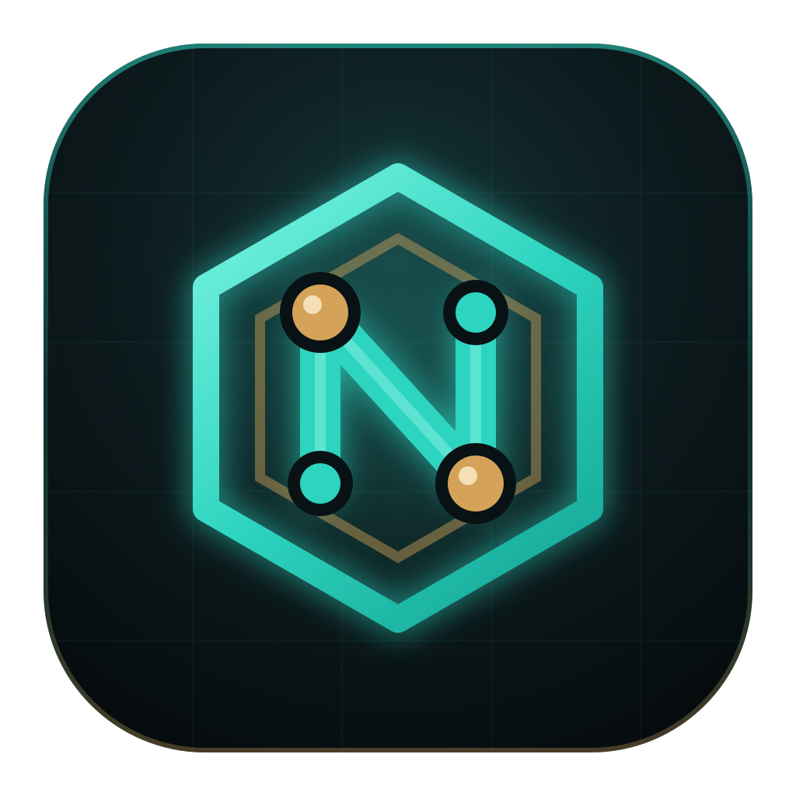
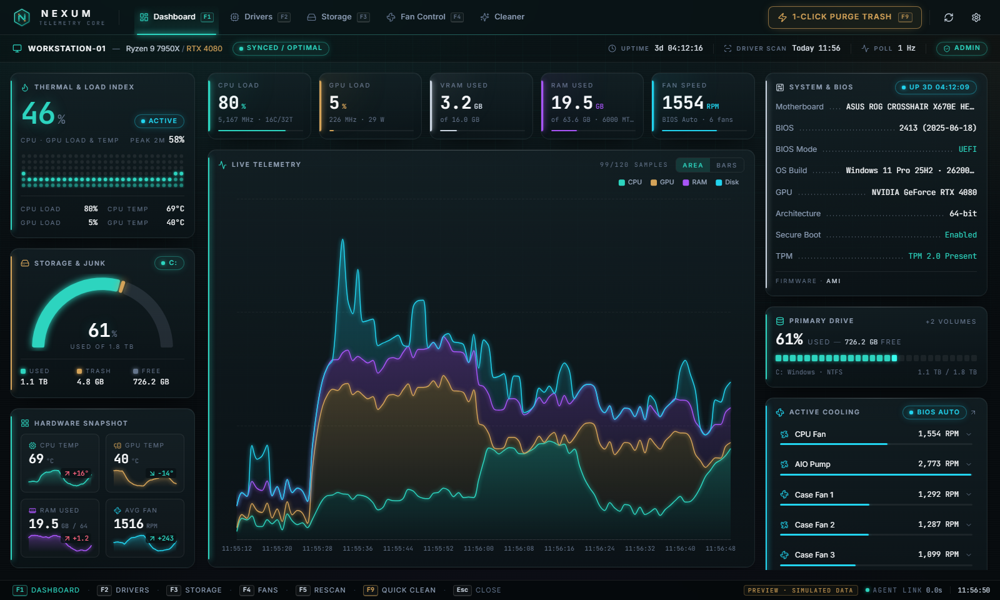

<p align="center">
  
</p>

<h1 align="center">Nexum</h1>

<p align="center">
  <b>BIOS-style PC telemetry, driver inventory and safe 1-click cleanup for Windows 10/11.</b><br/>
  Lightweight · native · open source (GPL-3.0)
</p>

<p align="center">
  <a href="../../actions/workflows/build.yml"></a>
</p>



> Screenshots are rendered with the built-in **preview data** (no hardware access in the browser preview).

## What it does

| Module | Highlights |
| --- | --- |
| **Live telemetry** | CPU load per core, clocks, package temp, voltage, power; GPU load, VRAM, clocks, hotspot, power, fan; RAM usage, speed, slots; every motherboard fan header with live RPM; real-time stacked telemetry graph. |
| **Fan control** | Silent / Balanced / Turbo / Auto (BIOS) presets and per-fan duty sliders (requires Administrator + a supported Super I/O chip). Fans always return to BIOS control when Nexum exits. |
| **Storage** | Physical drives (NVMe / SATA SSD / HDD), S.M.A.R.T. health, temperature, TBW, power-on hours, live read/write throughput, per-volume usage. |
| **Drivers & firmware** | Full driver audit (provider, version, date, WHQL signature, INF) across every device class; BIOS/UEFI, Secure Boot and TPM status; JSON/CSV export; driver backup via `pnputil`. |
| **1-Click Deep Purge** | Dry-run scan first, then cleans temp files, Recycle Bin, Windows Update download cache, GPU shader caches, optional browser caches (never cookies/logins), old crash dumps and logs, plus optional RAM standby-list flush. |

Keyboard: `F1` Dashboard · `F2` Drivers · `F3` Storage · `F4` Fans · `F5` Rescan · `F9` Quick Clean.

## Safety guarantees of the cleaner

* **Allow-list only.** Files are deleted solely *inside* a fixed set of known cache/temp folders; the folders themselves are never removed.
* **Immutable deny-list.** `System32`, `SysWOW64`, `WinSxS`, `Program Files`, registry hives, your Documents/Desktop/Pictures/Downloads/OneDrive and drive roots are refused after path canonicalization.
* **No link following.** Symlinks, junctions and mount points are skipped, never traversed.
* **Locked files are skipped**, never forced.
* **Dry run = real run.** The pre-scan and the purge use the same enumerator, so the "X GB ready to purge" figure is what actually gets removed.

Unit tests for these rules run in CI on every commit (`src-tauri/src/cleaner.rs`).

## Architecture

```
Tauri v2 (Rust) shell ── React + TypeScript + Tailwind UI (ECharts)
        │  NDJSON over stdio (1 Hz)
        ▼
nexum-agent (C# .NET 8 sidecar) ── LibreHardwareMonitorLib + WMI
```

See [`CONTRACT.md`](CONTRACT.md) for the exact IPC protocol and command surface.

## Building from source

Prerequisites: Node.js 22+, Rust (stable, MSVC), .NET 8 SDK, Visual Studio 2022 Build Tools ("Desktop development with C++").

```powershell
npm ci
npm run build
dotnet publish nexum-agent/NexumAgent.csproj -c Release -r win-x64 --self-contained true /p:PublishSingleFile=true -o build/agent
copy build\agent\nexum-agent.exe src-tauri\binaries\nexum-agent-x86_64-pc-windows-msvc.exe
npm run tauri -- build
```

Outputs: `src-tauri/target/release/Nexum.exe` and installers under `src-tauri/target/release/bundle/`.

UI-only development (no Rust needed — uses simulated data): `npm run dev` → http://localhost:1420.

Nexum requests Administrator rights on launch (needed for fan control, sensor drivers and cleaning `C:\Windows\Temp`).

## Code signing policy

Free code signing provided by [SignPath.io](https://about.signpath.io), certificate by [SignPath Foundation](https://signpath.org).

* Release binaries are built exclusively from this repository by GitHub Actions ([`build.yml`](.github/workflows/build.yml)) and signed via SignPath only from tagged releases.
* **Committers and reviewers:** [@captainRapipo](https://github.com/captainRapipo)
* **Approvers:** [@captainRapipo](https://github.com/captainRapipo)

Details: [`docs/SIGNING.md`](docs/SIGNING.md).

## Privacy policy

This program will not transfer any information to other networked systems unless specifically requested by the user or the person installing or operating it.

Nexum has no telemetry, analytics, accounts or auto-update calls. All sensor data stays on your PC. Network access happens only when *you* click a vendor driver-portal link (opens your browser) or when the installer downloads the Microsoft WebView2 runtime if it is missing.

## License

[GPL-3.0](LICENSE). Bundles [LibreHardwareMonitorLib](https://github.com/LibreHardwareMonitor/LibreHardwareMonitor) (MPL-2.0).

Nexum reads and controls hardware at a low level. It is provided **without warranty**; use fan control at your own risk.
